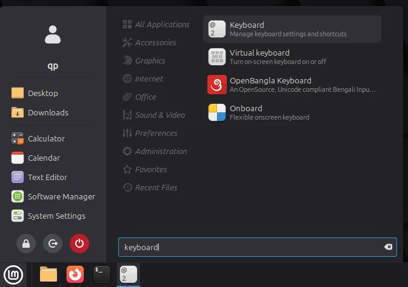
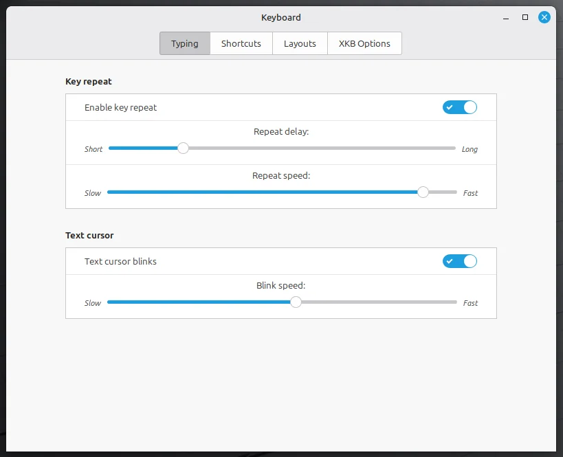
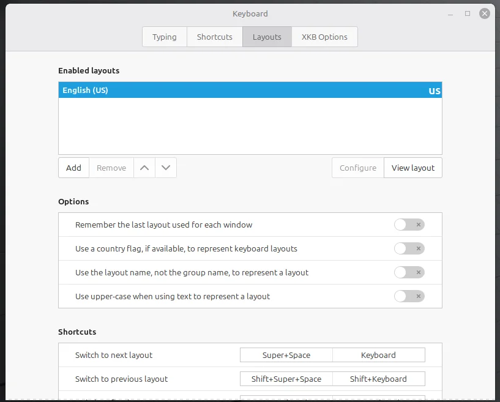
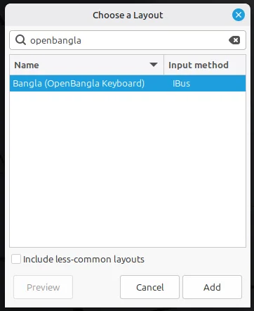

import { Step, Steps } from "fumadocs-ui/components/steps";
import { Callout } from "fumadocs-ui/components/callout";

<Steps>

<Step>

### Keyboard settings খুলুন

Open `System Settings > Keyboard`.

<Callout>You can use the search method to find it.</Callout>

</Step>

<Step>

### Layout যোগ করুন

Move to the **Layouts** tab and click **Add**, which will open a new tiny window. Search for `openbangla`, select **Bangla (OpenBangla Keyboard)**, and choose **IBus** as the input method.

</Step>

<Step>

### Layout পরিবর্তন করুন

You can switch to the next layout with <kbd>Super</kbd> + <kbd>Space</kbd>, or configure it to whatever you prefer.

</Step>

</Steps>
