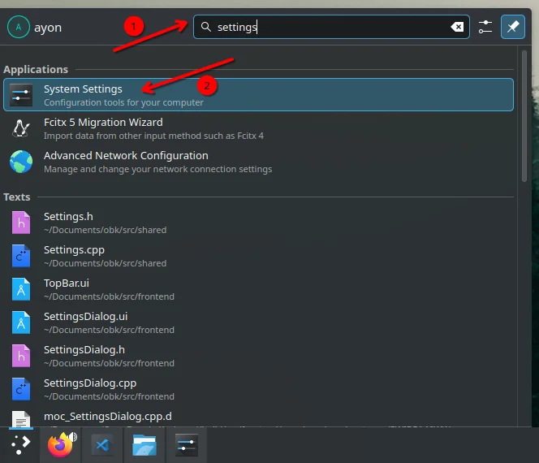
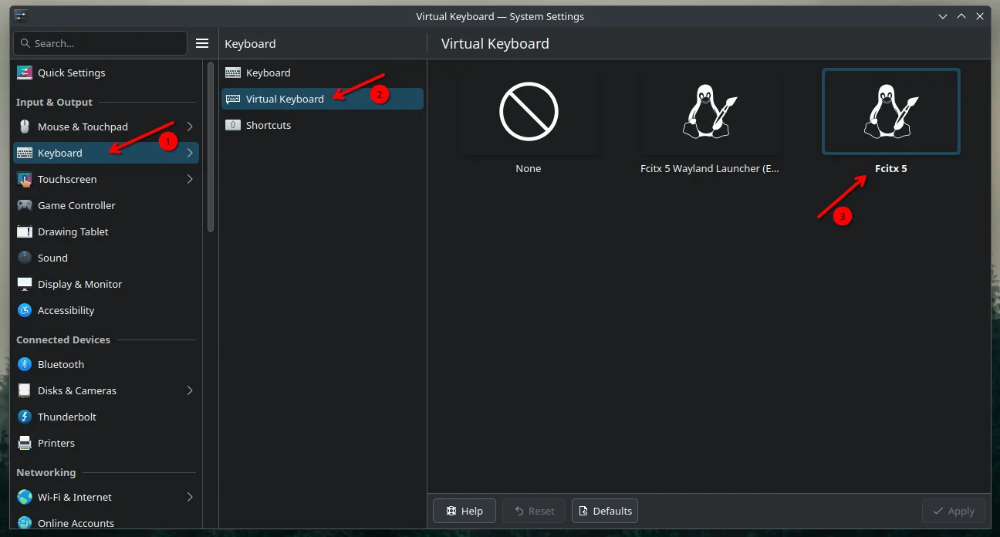
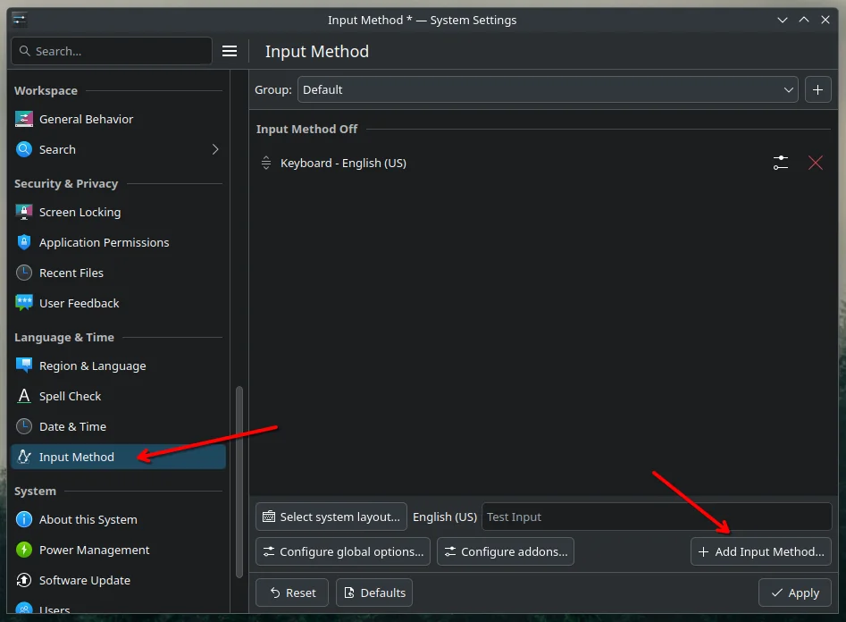
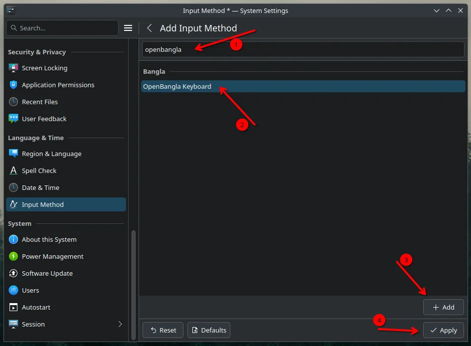

import { Step, Steps } from "fumadocs-ui/components/steps";

<Steps>

<Step>

### Open System Settings

Open `System Settings`.

</Step>

<Step>

### Set the virtual keyboard

Go into `Keyboard > Virtual Keyboard` and set the value to `Fcitx 5`.

</Step>

<Step>

### Open Input Methods

Look for `Input Methods` in the sidebar and click on it.

</Step>

<Step>

### Add OpenBangla Keyboard

English (US) should be added by default. Click **Add Input Method**, search for `openbangla`, add it to the list, then click **Apply**.

</Step>

</Steps>
