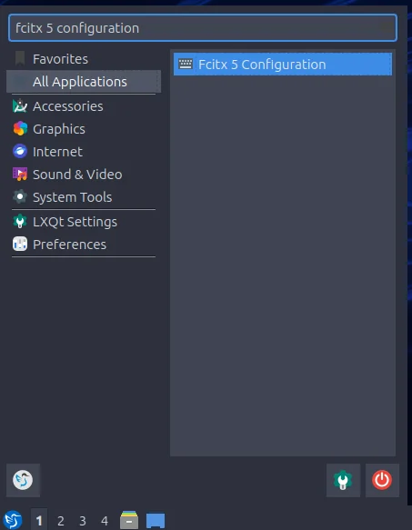
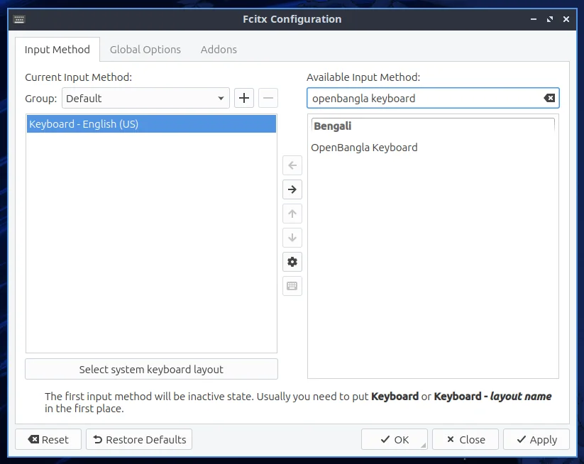
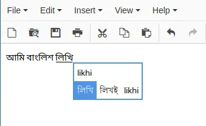

import { Step, Steps } from "fumadocs-ui/components/steps";

<Steps>

<Step>

### Open Fcitx 5 Configuration

Press the <kbd>Super</kbd> key, search for `fcitx 5 configuration` and open it.

</Step>

<Step>

### Add OpenBangla Keyboard

In the window that pops up, search for the input method named `openbangla keyboard`. Click the **OpenBangla Keyboard** item, add it by clicking the left arrow (←), then click **Apply**.

</Step>

<Step>

### Switch layouts

You can now switch layouts with the hotkey, which is <kbd>Ctrl</kbd> + <kbd>Space</kbd> by default.

</Step>

</Steps>
