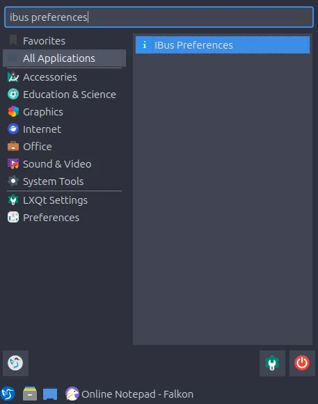
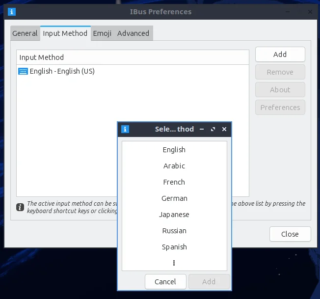
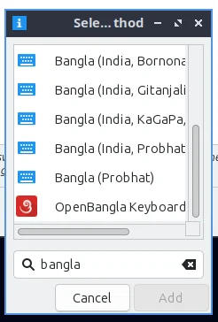
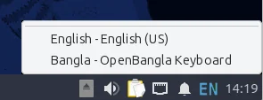
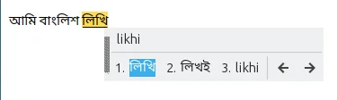

import { Step, Steps } from "fumadocs-ui/components/steps";

<Steps>

<Step>

### Open IBus Preferences

Press the <kbd>Super</kbd> key, search for `ibus preferences` and open it.

</Step>

<Step>

### Add an input method

Switch to the `Input Method` tab and click **Add**. Another small window will pop up.

</Step>

<Step>

### Select OpenBangla Keyboard

In the small window, click the dotted vertical line option and search for `bangla`. An item named **Bangla** should appear, so click on it. Scroll to the very bottom, select **OpenBangla Keyboard**, and click **Add**.

</Step>

<Step>

### Switch to OpenBangla Keyboard

In the bottom right there is an IBus panel icon. Click it and change to **Bangla - OpenBangla Keyboard**.

</Step>

</Steps>
