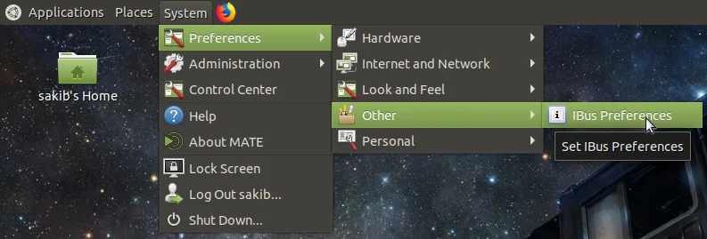
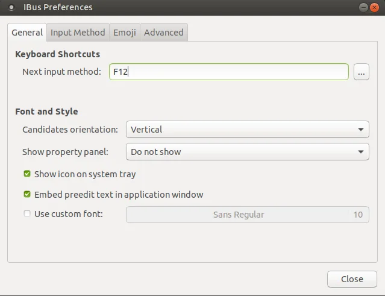
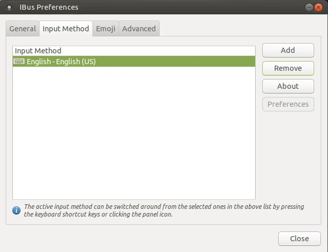
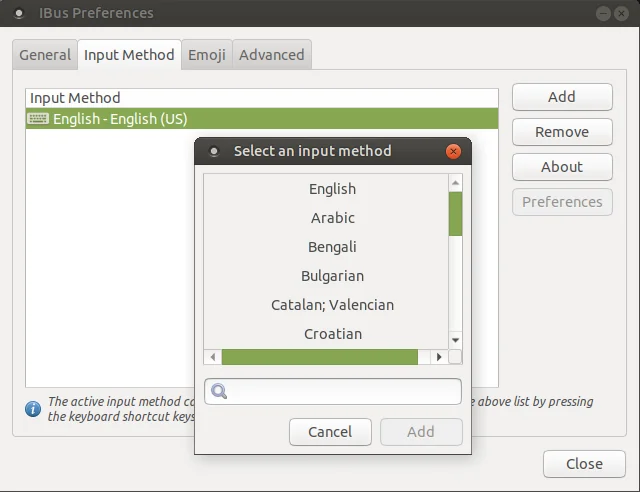
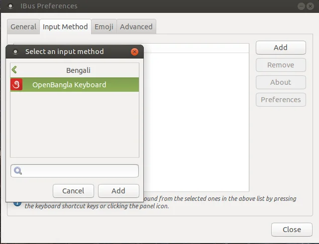
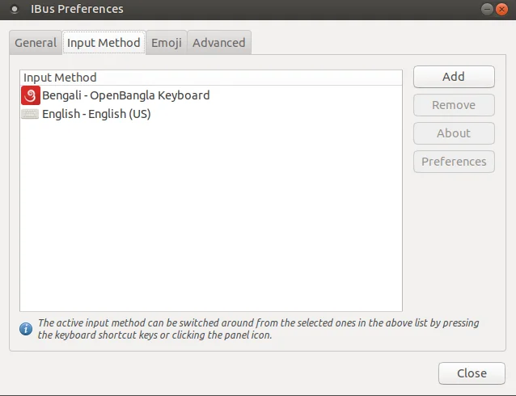

import { Step, Steps } from "fumadocs-ui/components/steps";
import { Callout } from "fumadocs-ui/components/callout";

<Callout type="warn" title="Before you start">
  Install [OpenBangla-Keyboard](https://github.com/OpenBangla/OpenBangla-Keyboard) first, following
  the [installation instructions](/docs/installation/linux).
</Callout>

<Steps>

<Step>

### Open IBus Preferences

From the top panel, go to `System > Preferences > Other > IBus Preferences`.

The **IBus Preferences** window will open.

</Step>

<Step>

### Add OpenBangla Keyboard

Select the **Input Method** tab.

Click **Add**, and a new window with a list of languages will pop up.

Select **Bengali**. You'll see the **OpenBangla Keyboard** layout listed there.

Select it and click **Add**. You'll now see two input methods listed on the **Input Method** tab.

</Step>

<Step>

### Choose a shortcut

Go to the **General** tab and choose a **Keyboard shortcut** for switching between English and OpenBangla Keyboard. In the screenshot below, <kbd>F12</kbd> is used.

</Step>

<Step>

### Reboot

Reboot your system.

<Callout type="warn">
  This is important. If you don't reboot, the changes might not take effect.
</Callout>

</Step>

</Steps>

That's it! You can now type Bangla using OpenBangla Keyboard whenever you like. To learn how to type with it, see [usage guide](/docs/usage).
