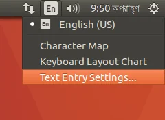
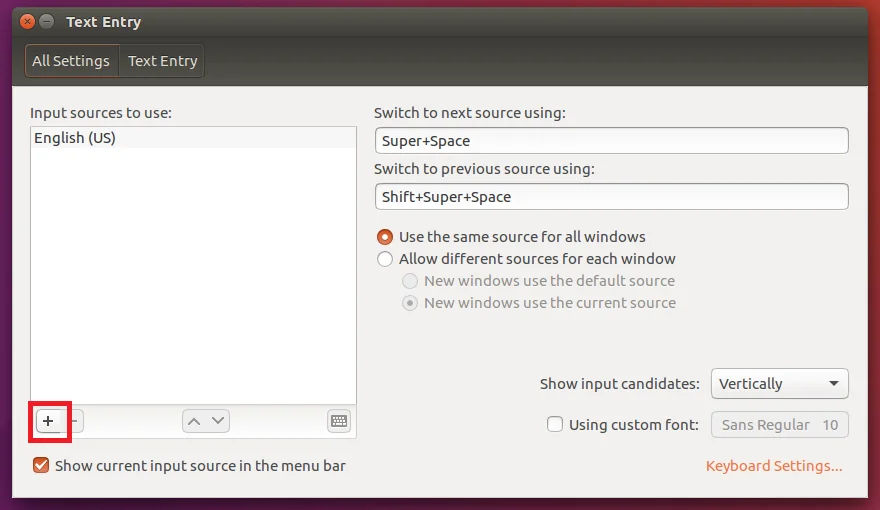
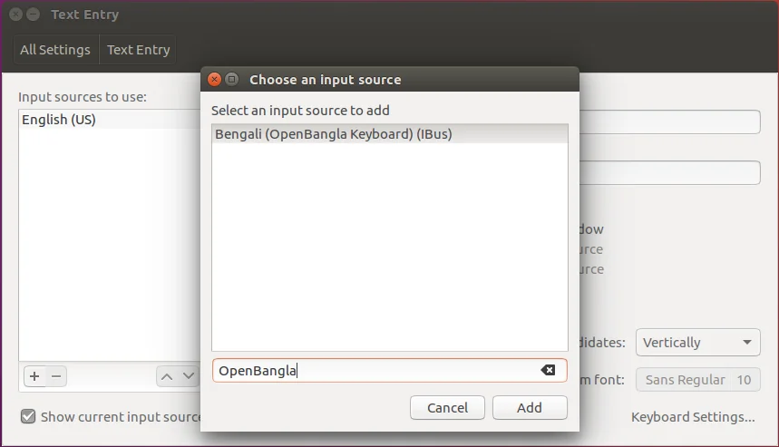

import { Step, Steps } from "fumadocs-ui/components/steps";
import { Callout } from "fumadocs-ui/components/callout";

<Callout type="warn" title="Before you start">
  Make sure you have installed
  [OpenBangla-Keyboard](https://github.com/OpenBangla/OpenBangla-Keyboard) before you proceed.
</Callout>

<Callout title="Legacy desktop">
  These instructions are for the Unity desktop, which was the default up to Ubuntu 17.04.
</Callout>

<Steps>

<Step>

### Open Text Entry Settings

Now that OpenBangla Keyboard is installed, we have to set it up. Open your `Text Entry Settings`.

</Step>

<Step>

### Add OpenBangla Keyboard

Click the `+` button. A dialog will show up.

Type `OpenBangla` in the search box and OpenBangla Keyboard will show up. Select it, click **Add**, then close the window.

</Step>

</Steps>

You have successfully set up OpenBangla Keyboard and it's ready for use! See [usage guide](/docs/usage) to learn how to type with it.
