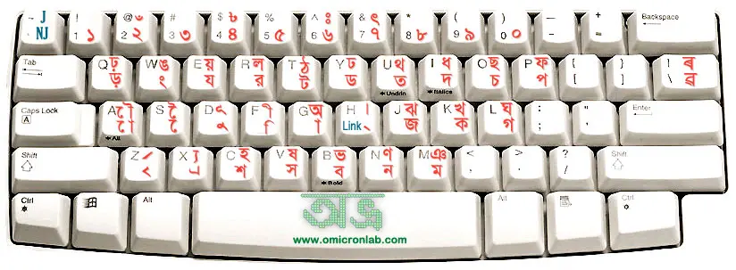
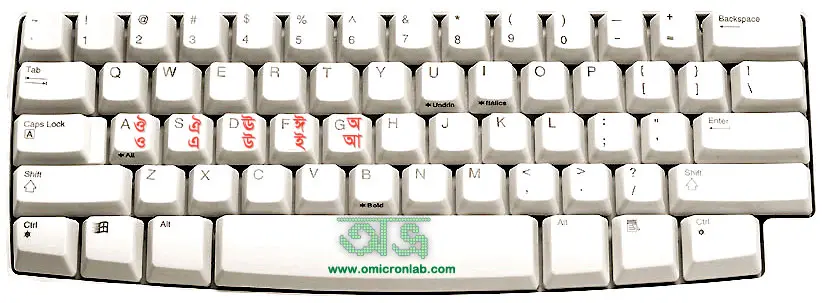

Avro Easy (অভ্র ইজি) হলো OmicronLab-এর অভ্র কিবোর্ড (Avro Keyboard)-এর একটি জনপ্রিয় Fixed Keyboard Layout ভিত্তিক বাংলা লেআউট। এই লেআউটটি OpenBangla Keyboard-এ সরাসরি অভ্র কিবোর্ড থেকে আমদানি করা হয়েছে, তাই এর প্রতিটি কী-ম্যাপিং অভ্র কিবোর্ডের আসল লেআউটের সঙ্গে হুবহু মিলে যায়।

**এই লেআউটের বৈশিষ্ট্য**

- Fixed Layout-গুলোর মধ্যে সবচেয়ে সহজবোধ্য — অভ্র কীবোর্ডের সাথে আসা নতুন ব্যবহারকারীদের জন্য পরিকল্পিত।
- কার ও পূর্ণ স্বরবর্ণ একই কলামে: `F` = ি/ই, `D` = ু/উ, `S` = ে/এ, `A` = ো/ও, `G` = া/আ — কার Normal লেয়ারে, পূর্ণ স্বরবর্ণ AltGr লেয়ারে।
- যুক্তবর্ণ-গঠনের চিহ্ন Bottom রো-তে এক জায়গায়: `X` = ্র/্য, `Z` = ়/র্।
- `G` কী-তে অ (Shift) ও আ (AltGr) — তাই অ-কারান্ত শব্দ লেখা সহজ।
- `H` কী হসন্ত; দুটি পরপর হসন্ত টাইপ করলে ZWNJ তৈরি হয়। Grave (`` ` ``) কী থেকেও ZWNJ/ZWJ মেলে।
- যারা একটি লেয়ার মুখস্থ করেই দুই লেয়ারে বাংলা লিখতে চান — Avro Easy তাদের জন্য সবচেয়ে উপযোগী।

Fixed Layout ভিত্তিক বাংলা লেখার নিয়মগুলো (Modern/Old টাইপিং স্টাইল, Automatic Vowel Forming, হসন্ত/ZWNJ/ZWJ, রেফ, চন্দ্রবিন্দু ঠিক করা, নাম্বার প্যাড ইত্যাদি) জানতে আগে [Fixed Layout Features](/docs/usage/fixed-layout-features) পৃষ্ঠাটি পড়ে নিন। পূর্ণ কী-ম্যাপিং [কী-ম্যাপ](/docs/usage/avro-easy/keymap) পৃষ্ঠায় দেওয়া আছে।

**বাংলা লেখা শুরু করা:**

১) OBK-র কিবোর্ড লেআউট হিসেবে Avro Easy সিলেক্ট করুন।

২) কিবোর্ড মোড বাংলা কীবোর্ডে নিয়ে আসুন।

৩) নিচের লেআউট ছবি অনুযায়ী কী চেপে বাংলা লিখতে থাকুন।

 

AltGr লেয়ারে অভ্র ইজিতে স্বরবর্ণের পূর্ণরূপ (আ-ই-ঈ-উ-ঊ-ও-এ-ঐ-অ-ঔ) রাখা হয়েছে, যাতে হসন্ত ছাড়াই পূর্ণ স্বরবর্ণ লেখা যায়:

<Callout type="info">
  <strong>লক্ষ করুন:</strong> উপরের ছবিগুলো অভ্র কিবোর্ডের অফিসিয়াল লেআউট ফাইলে বসানো ছবি (Avro
  Keyboard প্রকল্প / OmicronLab) থেকে নেওয়া হয়েছে। `Grave` কী (`` ` ``) থেকে ZWNJ ও Shift+`` ` ``
  থেকে ZWJ পাওয়া যায়।
</Callout>

## উদাহরণ

নিচে কিছু সাধারণ বাংলা শব্দ টাইপ করার ধাপ দেখানো হলো। Modern টাইপিং স্টাইলে (কার ক-এর পরে; হসন্ত `H`) টাইপ করলে যে ধাপগুলো আসে সেটাই দেখানো হয়েছে:

| বাংলা      | কী ধাপ                                                    |
| :--------- | :-------------------------------------------------------- |
| আমার       | `AltGr+G` + `M` + `G` + `R`                               |
| আজ         | `AltGr+G` + `J`                                           |
| বংলা       | `B` + `W` + `Shift+R` + `G`                               |
| ভাষা       | `Shift+B` + `G` + `Shift+V` + `G`                         |
| ক্মপিযুটার | `K` + `H` + `M` + `P` + `F` + `E` + `D` + `T` + `G` + `R` |
| ধন্যবাদ    | `Shift+I` + `N` + `H` + `E` + `B` + `G` + `I`             |
| স্বাগতম    | `V` + `H` + `B` + `G` + `L` + `U` + `M`                   |
| মানবতা     | `M` + `G` + `N` + `B` + `U` + `G`                         |
| শিক্ষা     | `C` + `F` + `K` + `H` + `Shift+V` + `G`                   |
| খাদ্য      | `Shift+K` + `G` + `I` + `H` + `E`                         |
| জল         | `J` + `Shift+R`                                           |
| পানি       | `P` + `G` + `N` + `F`                                     |
| ঘর         | `Shift+L` + `R`                                           |
| দেশ        | `I` + `S` + `C`                                           |
| মা         | `M` + `G`                                                 |
| পিতা       | `P` + `F` + `U` + `G`                                     |
| শহর        | `C` + `Shift+C` + `R`                                     |
| রাস্তা     | `R` + `G` + `V` + `H` + `U` + `G`                         |
| স্কুল      | `V` + `H` + `K` + `D` + `Shift+R`                         |
| টাকা       | `T` + `G` + `K` + `G`                                     |
| আমরা       | `AltGr+G` + `M` + `R` + `G`                               |
| এখন        | `AltGr+S` + `Shift+K` + `N`                               |
| কি         | `K` + `F`                                                 |
| ছুটি       | `Shift+O` + `D` + `T` + `F`                               |
| গান        | `L` + `G` + `N`                                           |
| দিন        | `I` + `F` + `N`                                           |
| রাত        | `R` + `G` + `U`                                           |
| সব         | `V` + `B`                                                 |

`` `Shift+X` `` মানে `Shift` চেপে `X` কী; `` `AltGr+G` `` মানে `AltGr` চেপে `G` কী; `` `H` `` হলো হসন্ত কী।

এই শব্দগুলো হুবহু টাইপ করে দেখুন, তারপর [Fixed Layout Features](/docs/usage/fixed-layout-features)-এর নিয়মগুলো মিলিয়ে নিন।
