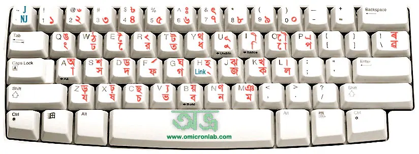

Borno (বর্ণ) হলো The Safeworks-এর মূল "Bornona" লেআউটের (১৯৯৬–১৯৯৮) Unicode রূপ। OmicronLab এই লেআউটটি একটু পরিবর্তন করে Unicode সমর্থন যোগ করেছে এবং OpenBangla Keyboard-এ এটি সরাসরি অভ্র কিবোর্ড (Avro Keyboard) থেকে আমদানি করা হয়েছে।

<Callout type="info">
  <strong>লক্ষ করুন:</strong> এটি আজকের Codepotro "Borno" লেআউটের সঙ্গে মিলে না — এই লেআউটটি The
  Safeworks-এর Bornona লেআউটের উপর ভিত্তি করে তৈরি।
</Callout>

**এই লেআউটের বৈশিষ্ট্য**

- The Safeworks-এর মূল Bornona (১৯৯৬–১৯৯৮) লেআউটের Unicode রূপ; OmicronLab এটিকে Unicode সমর্থন দিয়ে সাজিয়েছেন।
- AltGr লেয়ার নেই — Normal ও Shift, এই দুইটি লেয়ারেই সম্পূর্ণ বর্ণমালা রাখা হয়েছে।
- পূর্ণ স্বরবর্ণের আলাদা কী নেই; `H` (হসন্ত) + কার পরপর টাইপ করলে Automatic Vowel Forming দিয়ে পূর্ণ স্বরবর্ণ তৈরি হয় — যেমন `H A` = আ, `H E` = এ, `H U` = উ।
- অনুস্বার `Q` কী-তে (ং), ঙ `W` কী-তে — সবই ছড়ানো না, ঘনীভূত দুটি লেয়ারে।
- হসন্তের অবস্থান Home রো-তে `H` — যুক্তবর্ণ লেখার সময় আঙুল দূরে যেতে হয় না।
- যারা দুই লেয়ারেই শুধু কীবোর্ড চেপে টাইপ করতে অভ্যস্ত — Borno তাদের কাছে সবচেয়ে পরিচিত fixed লেআউট।

Fixed Layout ভিত্তিক বাংলা লেখার নিয়মগুলো (Modern/Old টাইপিং স্টাইল, Automatic Vowel Forming, হসন্ত/ZWNJ/ZWJ, রেফ, চন্দ্রবিন্দু ঠিক করা, নাম্বার প্যাড ইত্যাদি) জানতে আগে [Fixed Layout Features](/docs/usage/fixed-layout-features) পৃষ্ঠাটি পড়ে নিন। পূর্ণ কী-ম্যাপিং [কী-ম্যাপ](/docs/usage/borno/keymap) পৃষ্ঠায় দেওয়া আছে।

**বাংলা লেখা শুরু করা:**

১) OBK-র কিবোর্ড লেআউট হিসেবে Borno সিলেক্ট করুন।

২) কিবোর্ড মোড বাংলা কীবোর্ডে নিয়ে আসুন।

৩) নিচের লেআউট ছবি অনুযায়ী কী চেপে বাংলা লিখতে থাকুন।

 

Borno-তে AltGr লেয়ার নেই; শুধু Normal ও Shift — এই দুইটি লেয়ারেই সব বর্ণ আছে। `Grave` কী (`` ` ``) থেকে ZWNJ ও Shift+`` ` `` থেকে ZWJ পাওয়া যায়।

<Callout type="info">
  <strong>লক্ষ করুন:</strong> উপরের ছবিটি অভ্র কিবোর্ডের অফিসিয়াল লেআউট ফাইলে বসানো ছবি (Avro
  Keyboard প্রকল্প / OmicronLab) থেকে নেওয়া হয়েছে। অভ্র কিবোর্ডের অফিসিয়াল Borno লেআউটে `Grave`
  কীর Shift অবস্থায় `~` (টিলডা) থাকলেও OpenBangla Keyboard-র Borno-তে সেখানে ZWJ বসানো হয়েছে।
</Callout>

## উদাহরণ

নিচে কিছু সাধারণ বাংলা শব্দ টাইপ করার ধাপ দেখানো হলো। Modern টাইপিং স্টাইলে (কার ক-এর পরে; হসন্ত `H`) টাইপ করলে যে ধাপগুলো আসে সেটাই দেখানো হয়েছে:

| বাংলা      | কী ধাপ                                                          |
| :--------- | :-------------------------------------------------------------- |
| আমার       | `H` + `A` + `M` + `A` + `R`                                     |
| আজ         | `H` + `A` + `J`                                                 |
| বংলা       | `B` + `Q` + `L` + `A`                                           |
| ভাষা       | `V` + `A` + `X` + `A`                                           |
| ক্মপিযুটার | `K` + `H` + `M` + `P` + `I` + `Z` + `U` + `Shift+T` + `A` + `R` |
| ধন্যবাদ    | `Y` + `N` + `H` + `Z` + `B` + `A` + `D`                         |
| স্বাগতম    | `S` + `H` + `B` + `A` + `G` + `T` + `M`                         |
| মানবতা     | `M` + `A` + `N` + `B` + `T` + `A`                               |
| শিক্ষা     | `Shift+S` + `I` + `K` + `H` + `X` + `A`                         |
| খাদ্য      | `Shift+K` + `A` + `D` + `H` + `Z`                               |
| জল         | `J` + `L`                                                       |
| পানি       | `P` + `A` + `N` + `I`                                           |
| ঘর         | `Shift+G` + `R`                                                 |
| দেশ        | `D` + `E` + `Shift+S`                                           |
| মা         | `M` + `A`                                                       |
| পিতা       | `P` + `I` + `T` + `A`                                           |
| শহর        | `Shift+S` + `Shift+H` + `R`                                     |
| রাস্তা     | `R` + `A` + `S` + `H` + `T` + `A`                               |
| স্কুল      | `S` + `H` + `K` + `U` + `L`                                     |
| টাকা       | `Shift+T` + `A` + `K` + `A`                                     |
| আমরা       | `H` + `A` + `M` + `R` + `A`                                     |
| এখন        | `H` + `E` + `Shift+K` + `N`                                     |
| কি         | `K` + `I`                                                       |
| ছুটি       | `Shift+C` + `U` + `Shift+T` + `I`                               |
| গান        | `G` + `A` + `N`                                                 |
| দিন        | `D` + `I` + `N`                                                 |
| রাত        | `R` + `A` + `T`                                                 |
| সব         | `S` + `B`                                                       |

`` `Shift+X` `` মানে `Shift` চেপে `X` কী; `` `AltGr+G` `` মানে `AltGr` চেপে `G` কী; `` `H` `` হলো হসন্ত কী।

<Callout type="info">
  <strong>লক্ষ করুন:</strong> Borno-তে পূর্ণ স্বরবর্ণের আলাদা কী নেই — <code>H</code> (হসন্ত) ও কার
  পরপর টাইপ করলে Automatic Vowel Forming থেকে পূর্ণ স্বরবর্ণ তৈরি হয় (যেমন <code>H A</code> = আ,{" "}
  <code>H E</code> = এ)। তাই উপরের কিছু ধাপে
  <code>H</code> + কার দেখা যাচ্ছে।
</Callout>

এই শব্দগুলো হুবহু টাইপ করে দেখুন, তারপর [Fixed Layout Features](/docs/usage/fixed-layout-features)-এর নিয়মগুলো মিলিয়ে নিন।
