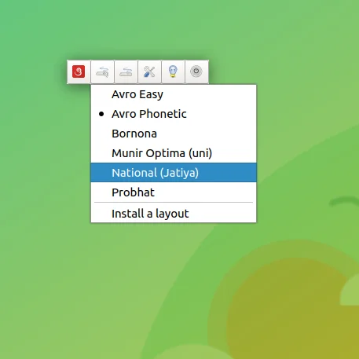

প্রথমে OpenBangla-Keyboard টি চালু করুন এখানে দেখানো [পদ্ধতিতে](/docs/usage/getting-started)।
সফল ভাবে চালু করার পর এরকম একটি UI দেখতে পাবেন।

By default OpenBangla-Keyboard এ `Avro Phonetic` লে-আউট চালু থাকবে । যদি আপনি তা পরিবর্তন করতে চান তবে `Change Layout` বাটনে ( লাল লোগো এর ডানে ) ক্লিক করুন। ক্লিক করলে নিচের মত Drop Down Menu দেখতে পারবেন :

এই Drop Down Menu থেকে আপনার পছন্দ মত যেকোন লে-আউট সিলেক্ট করে ব্যাবহার শুরু করতে পারবেন।

শুধু তাই নয়, Drop Down Menu থেকে `Install a layout` এ ক্লিক করে আপনি অভ্র কিবোর্ড এর লে-আউট ও ব্যাবহার করতে পারবেন। তবে লেআউট এর ভার্সন ৫ হতে হবে ।
