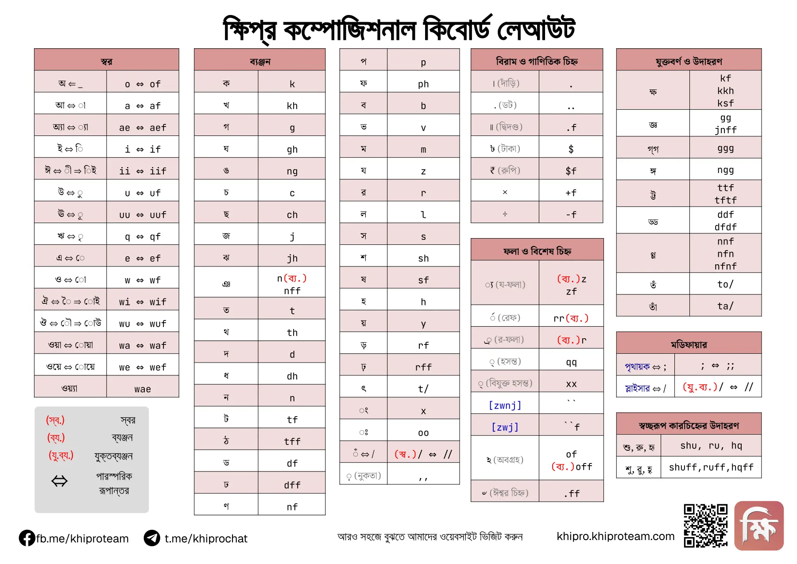

<Callout type="warn">
  <strong>Khipro এখনো উন্নয়নাধীন:</strong> এই ডকুমেন্টেশন হাতে রক্ষণাবেক্ষণ করা হয়, তাই কিবোর্ডের
  সর্বশেষ অবস্থার সাথে সবসময় মিলে নাও যেতে পারে। সর্বশেষ ও হালনাগাদ তথ্যের জন্য
  [khipro.khiproteam.com](https://khipro.khiproteam.com) দেখুন।
</Callout>

ক্ষিপ্র (Khipro) হলো "Khipro Team"-এর তৈরি একটি কম্পোজিশনাল ট্রান্সলিটারেশন বাংলা কিবোর্ড লেআউট। দ্রুততম বাংলা টাইপিংয়ের জন্য ক্ষিপ্র কিবোর্ড লেআউট শিখুন।

ক্ষিপ্রের পূর্ণাঙ্গ ব্যবহার-নির্দেশিকা ও কনসেপ্ট অফিসিয়াল ওয়েবসাইটে পাওয়া যায়: [khipro.khiproteam.com](https://khipro.khiproteam.com)। লেআউটটি ইনস্টল করার পদ্ধতি [ওয়েবসাইটের ইনস্টলেশন সেকশনে](https://khipro.khiproteam.com/#installation) দেওয়া আছে।

## ক্ষিপ্র কনসেপ্ট

ক্ষিপ্র একটি কম্পোজিশনাল লেআউট — এখানে প্রতিটি কী সরাসরি একটি বাংলা বর্ণের সঙ্গে বসে না, বরং রোমান হরফের সমাবেশ (কম্পোজিশন) দিয়ে বাংলা বর্ণ, কারচিহ্ন ও যুক্তবর্ণ গঠন করা হয়। সাধারণ ফোনেটিক লেআউটের মতো কেবল উচ্চারণমূলক কী-ম্যাপিং নয়, বরং এখানে বর্ণ গঠনের নিয়মাবলি আছে; ফলে যুক্তবর্ণ, কারচিহ্ন, স্বরবর্ণ ও বিশেষ চিহ্নসমূহ অত্যন্ত কম কিস্ট্রোক-এ লেখা যায়।

এই কম্পোজিশনাল কাজের পেছনে দুইটি মূল ধারণা কাজ করে:

- **পৃথায়ক:** সেমিকোলন `;` — লেখাকে ছিন্নায়িত বা অংশায়িত করে এবং যুক্তবর্ণ গঠন রোধ করে।
- **মডিফায়ার:** `f` (⁌), স্ল্যাশ `/` এবং ব্যাকস্ল্যাশ `\` — স্বরবর্ণ ও কারচিহ্নের আন্তঃরূপান্তর, চন্দ্রবিন্দু, খণ্ড-ত, স্বচ্ছ গ্লিফ ইত্যাদি লেখার জন্য।

উদাহরণ স্বরূপ, `jh` দিলে `ঝ` পাওয়া যায়, আর `j;h` দিলে পৃথায়কের কারণে `জহ` পাওয়া যায়। একইভাবে `ka` = `কা`, কিন্তু `k;a` = `কআ`।

<Callout type="info">
  <strong>ক্ষিপ্র কিবোর্ডের ডেভেলপার:</strong> Khipro Team। অফিসিয়াল সাইট:
  [https://khipro.khiproteam.com](https://khipro.khiproteam.com)।
</Callout>

বাকি পৃষ্ঠাগুলোতে ধাপে ধাপে লেআউটটি শিখে নিন:

- [কুইকস্টার্ট](/docs/usage/khipro/quickstart) — কয়েকটি উদাহরণ দিয়ে টাইপিং শুরু করুন।
- [স্বরবর্ণ ও স্বরচিহ্ন](/docs/usage/khipro/vowels-and-kar)
- [ব্যঞ্জনবর্ণ ও যুক্তবর্ণ](/docs/usage/khipro/consonants-and-conjuncts)
- [মডিফায়ার ও বিশেষ চিহ্ন](/docs/usage/khipro/modifiers-and-special)
- [যুক্তবর্ণের পূর্ণাঙ্গ তালিকা](/docs/usage/khipro/juktoborno-list)
