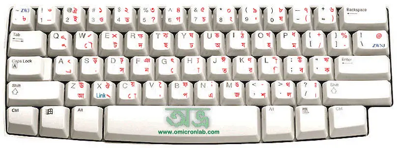
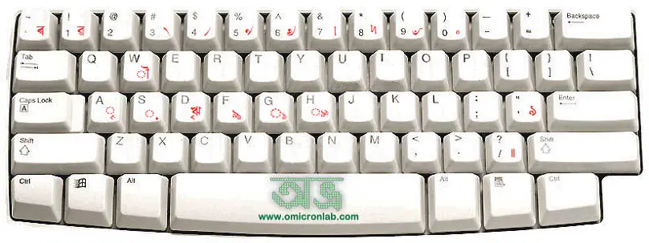

Munir Optima (মুনির অপটিমা) হলো Shabab Mustafa-এর তৈরি একটি জনপ্রিয় Fixed Keyboard Layout ভিত্তিক বাংলা লেআউট। এটি Munir Optima কিবোর্ডের Unicode সংস্করণ, যা Ekushey.org-এর পরামর্শে তৈরি হয়েছিল এবং OpenBangla Keyboard-এ সরাসরি অভ্র কিবোর্ড (Avro Keyboard) থেকে আমদানি করা হয়েছে।

**এই লেআউটের বৈশিষ্ট্য**

- Shabab Mustafa-এর তৈরি; Ekushey.org-এর পরামর্শে Unicode সংস্করণ, পরে অভ্র কিবোর্ডে যুক্ত হয়েছে।
- পূর্ণ স্বরবর্ণ ছড়ানো অবস্থায়: `Z` = আ/ঊ, `J` Shift = ঈ, `;` Shift = উ, `'` Shift = ঋ; কার `Q`, `L`, `H`, `G` কী-তে।
- ডিজিট রো সাধারণ লেআউট থেকে আলাদা: Normal-এ `1` = `_`, `2` = ই, `3` = ও; বাংলা ডিজিট Shift-এ, আর ৱ ৲ ৴–৶ ৷ ৸ ৺ ৹ AltGr-এ।
- AltGr লেয়ারে বিরল বর্ণ: ৗ (`W`), ৄ ় ৠ ৡ ৢ ৣ ঌ (Home রো), ॥ (`/`) ও ৰ (Grave)।
- `Grave` কী (`` ` ``): Normal = `৳`, Shift = ZWJ, AltGr = `ৰ`।
- Shift+AltGr লেয়ারে কিছুই নেই; সব বাড়তি চিহ্ন AltGr লেয়ারেই রাখা হয়েছে।
- `Shift+E` থেকে <code>U+F0B4</code> (Symbol ফন্টের PUA অক্ষর) আসে — সাধারণ ফন্টে দেখাবে না।

Fixed Layout ভিত্তিক বাংলা লেখার নিয়মগুলো (Modern/Old টাইপিং স্টাইল, Automatic Vowel Forming, হসন্ত/ZWNJ/ZWJ, রেফ, চন্দ্রবিন্দু ঠিক করা, নাম্বার প্যাড ইত্যাদি) জানতে আগে [Fixed Layout Features](/docs/usage/fixed-layout-features) পৃষ্ঠাটি পড়ে নিন। পূর্ণ কী-ম্যাপিং [কী-ম্যাপ](/docs/usage/munir-optima/keymap) পৃষ্ঠায় দেওয়া আছে।

**বাংলা লেখা শুরু করা:**

১) OBK-র কিবোর্ড লেআউট হিসেবে Munir Optima সিলেক্ট করুন।

২) কিবোর্ড মোড বাংলা কীবোর্ডে নিয়ে আসুন।

৩) নিচের লেআউট ছবি অনুযায়ী কী চেপে বাংলা লিখতে থাকুন।

 

AltGr লেয়ারে ৲, ৴–৹, ৺-এর মতো বিরল বাংলা সংখ্যামূলক অক্ষরসহ বাড়তি বর্ণ রাখা হয়েছে (Shift+AltGr লেয়ারে কিছু নেই):

<Callout type="info">
  <strong>লক্ষ করুন:</strong> উপরের ছবিগুলো অভ্র কিবোর্ডের অফিসিয়াল লেআউট ফাইলে বসানো ছবি (Avro
  Keyboard প্রকল্প / OmicronLab) থেকে নেওয়া হয়েছে। `Grave` কী (`` ` ``) থেকে `৳`, Shift+`` ` ``
  থেকে ZWJ ও AltGr+`` ` `` থেকে `ৰ` পাওয়া যায়।
</Callout>

## উদাহরণ

নিচে কিছু সাধারণ বাংলা শব্দ টাইপ করার ধাপ দেখানো হলো। Modern টাইপিং স্টাইলে (কার ক-এর পরে; হসন্ত `H`) টাইপ করলে যে ধাপগুলো আসে সেটাই দেখানো হয়েছে:

| বাংলা      | কী ধাপ                                                    |
| :--------- | :-------------------------------------------------------- |
| আমার       | `Z` + `P` + `H` + `K`                                     |
| আজ         | `Z` + `M`                                                 |
| বংলা       | `;` + `8` + `.` + `H`                                     |
| ভাষা       | `Shift+U` + `H` + `0` + `H`                               |
| ক্মপিযুটার | `'` + `X` + `P` + `B` + `L` + `I` + `Q` + `E` + `H` + `K` |
| ধন্যবাদ    | `Shift+P` + `F` + `X` + `I` + `;` + `H` + `R`             |
| স্বাগতম    | `D` + `X` + `;` + `H` + `6` + `J` + `P`                   |
| মানবতা     | `P` + `H` + `F` + `;` + `J` + `H`                         |
| শিক্ষা     | `,` + `L` + `'` + `X` + `0` + `H`                         |
| খাদ্য      | `Shift+O` + `H` + `R` + `X` + `I`                         |
| জল         | `M` + `.`                                                 |
| পানি       | `B` + `H` + `F` + `L`                                     |
| ঘর         | `Shift+Y` + `K`                                           |
| দেশ        | `R` + `G` + `,`                                           |
| মা         | `P` + `H`                                                 |
| পিতা       | `B` + `L` + `J` + `H`                                     |
| শহর        | `,` + `O` + `K`                                           |
| রাস্তা     | `K` + `H` + `D` + `X` + `J` + `H`                         |
| স্কুল      | `D` + `X` + `'` + `Q` + `.`                               |
| টাকা       | `E` + `H` + `'` + `H`                                     |
| আমরা       | `Z` + `P` + `K` + `H`                                     |
| এখন        | `N` + `Shift+O` + `F`                                     |
| কি         | `'` + `L`                                                 |
| ছুটি       | `T` + `Q` + `E` + `L`                                     |
| গান        | `6` + `H` + `F`                                           |
| দিন        | `R` + `L` + `F`                                           |
| রাত        | `K` + `H` + `J`                                           |
| সব         | `D` + `;`                                                 |

`` `Shift+X` `` মানে `Shift` চেপে `X` কী; `` `AltGr+G` `` মানে `AltGr` চেপে `G` কী; `` `H` `` হলো হসন্ত কী।

এই শব্দগুলো হুবহু টাইপ করে দেখুন, তারপর [Fixed Layout Features](/docs/usage/fixed-layout-features)-এর নিয়মগুলো মিলিয়ে নিন।
