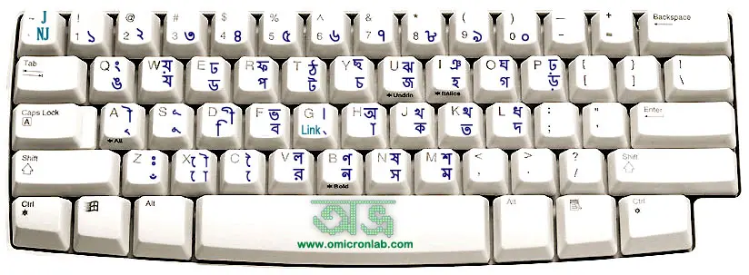
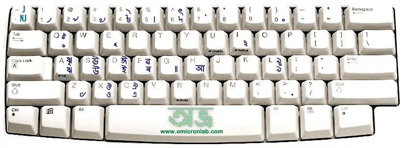

National (Jatiya) (জাতীয়) হলো Bangladesh Computer Council (BCC)-এর তৈরি "Bangla Jatiyo Keyboard" বা জাতীয় কিবোর্ড লেআউটের Fixed Keyboard Layout ভিত্তিক রূপ। এটি বর্তমানে সবচেয়ে জনপ্রিয় লেআউটগুলোর একটি এবং বাংলা কিবোর্ডের মানক লেআউট হিসেবে বিবেচিত। OpenBangla Keyboard-এ এই লেআউটটি অভ্র কিবোর্ড (Avro Keyboard) থেকে আমদানি করা হয়েছে।

**এই লেআউটের বৈশিষ্ট্য**

- Bangladesh Computer Council (BCC)-এর "Bangla Jatiyo Keyboard" (জাতীয় কিবোর্ড) — বাংলাদেশের সরকারি বাংলা কিবোর্ড মান।
- সরকারি দপ্তর, অফিস-আদালত ও শিক্ষা প্রতিষ্ঠানে বহুল ব্যবহৃত; সবচেয়ে জনপ্রিয় fixed লেআউটগুলোর একটি।
- কার Normal লেয়ারে, পূর্ণ স্বরবর্ণ AltGr লেয়ারে; AltGr ও Shift+AltGr-এ ঋ, ৠ, ৡ, ৢ, ৣ, ঽ, ৺-সহ বিরল বর্ণ/চিহ্ন রাখা আছে।
- OpenBangla Keyboard-এ মানকের সাথে তিনটি AltGr শর্টকাট যোগ করা হয়েছে: `AltGr+0` = ৹, `AltGr+J` = ক্ষ, `AltGr+K` = ৎ।
- `Grave` (`` ` ``) কী পুরো ZWNJ/ZWJ জোড়ার জন্য নিবেদিত — Normal/AltGr = ZWNJ, Shift/Shift+AltGr = ZWJ।
- যারা জাতীয় মান অনুসরণ করতে বাধ্য (সরকারি কাজ) — National (Jatiya) তাদের আদর্শ পছন্দ।

Fixed Layout ভিত্তিক বাংলা লেখার নিয়মগুলো (Modern/Old টাইপিং স্টাইল, Automatic Vowel Forming, হসন্ত/ZWNJ/ZWJ, রেফ, চন্দ্রবিন্দু ঠিক করা, নাম্বার প্যাড ইত্যাদি) জানতে আগে [Fixed Layout Features](/docs/usage/fixed-layout-features) পৃষ্ঠাটি পড়ে নিন। পূর্ণ কী-ম্যাপিং [কী-ম্যাপ](/docs/usage/national-jatiya/keymap) পৃষ্ঠায় দেওয়া আছে।

**বাংলা লেখা শুরু করা:**

১) OBK-র কিবোর্ড লেআউট হিসেবে National (Jatiya) সিলেক্ট করুন।

২) কিবোর্ড মোড বাংলা কীবোর্ডে নিয়ে আসুন।

৩) নিচের লেআউট ছবি অনুযায়ী কী চেপে বাংলা লিখতে থাকুন।

 

AltGr ও Shift+AltGr লেয়ারে ঋ, ৠ, ৡ, ৢ, ৣ, ঽ, ৺-এর মতো বাড়তি বর্ণ ও চিহ্ন রাখা হয়েছে:

<Callout type="info">
  <strong>লক্ষ করুন:</strong> উপরের ছবিগুলো অভ্র কিবোর্ডের অফিসিয়াল লেআউট ফাইলে বসানো ছবি (Avro
  Keyboard প্রকল্প / OmicronLab) থেকে নেওয়া হয়েছে। `Grave` কী (`` ` ``) থেকে ZWNJ, Shift+`` ` ``
  থেকে ZWJ, AltGr+`` ` `` থেকে ZWNJ ও Shift+AltGr+`` ` `` থেকে ZWJ পাওয়া যায়। OpenBangla
  Keyboard-র এই লেআউটে মানক লেআউটে না থাকা তিনটি AltGr শর্টকাট আছে — বিস্তারিত
  [কী-ম্যাপ](/docs/usage/national-jatiya/keymap) পৃষ্ঠায় দেখুন।
</Callout>

## উদাহরণ

নিচে কিছু সাধারণ বাংলা শব্দ টাইপ করার ধাপ দেখানো হলো। Modern টাইপিং স্টাইলে (কার ক-এর পরে; হসন্ত `H`) টাইপ করলে যে ধাপগুলো আসে সেটাই দেখানো হয়েছে:

| বাংলা      | কী ধাপ                                                    |
| :--------- | :-------------------------------------------------------- |
| আমার       | `AltGr+H` + `M` + `H` + `V`                               |
| আজ         | `AltGr+H` + `U`                                           |
| বংলা       | `F` + `Shift+Q` + `Shift+V` + `H`                         |
| ভাষা       | `Shift+F` + `H` + `Shift+N` + `H`                         |
| ক্মপিযুটার | `J` + `G` + `M` + `R` + `D` + `W` + `S` + `T` + `H` + `V` |
| ধন্যবাদ    | `Shift+L` + `B` + `G` + `W` + `F` + `H` + `L`             |
| স্বাগতম    | `N` + `G` + `F` + `H` + `O` + `K` + `M`                   |
| মানবতা     | `M` + `H` + `B` + `F` + `K` + `H`                         |
| শিক্ষা     | `Shift+M` + `D` + `J` + `G` + `Shift+N` + `H`             |
| খাদ্য      | `Shift+J` + `H` + `L` + `G` + `W`                         |
| জল         | `U` + `Shift+V`                                           |
| পানি       | `R` + `H` + `B` + `D`                                     |
| ঘর         | `Shift+O` + `V`                                           |
| দেশ        | `L` + `C` + `Shift+M`                                     |
| মা         | `M` + `H`                                                 |
| পিতা       | `R` + `D` + `K` + `H`                                     |
| শহর        | `Shift+M` + `I` + `V`                                     |
| রাস্তা     | `V` + `H` + `N` + `G` + `K` + `H`                         |
| স্কুল      | `N` + `G` + `J` + `S` + `Shift+V`                         |
| টাকা       | `T` + `H` + `J` + `H`                                     |
| আমরা       | `AltGr+H` + `M` + `V` + `H`                               |
| এখন        | `AltGr+C` + `Shift+J` + `B`                               |
| কি         | `J` + `D`                                                 |
| ছুটি       | `Shift+Y` + `S` + `T` + `D`                               |
| গান        | `O` + `H` + `B`                                           |
| দিন        | `L` + `D` + `B`                                           |
| রাত        | `V` + `H` + `K`                                           |
| সব         | `N` + `F`                                                 |

`` `Shift+X` `` মানে `Shift` চেপে `X` কী; `` `AltGr+G` `` মানে `AltGr` চেপে `G` কী; `` `H` `` হলো হসন্ত কী।

এই শব্দগুলো হুবহু টাইপ করে দেখুন, তারপর [Fixed Layout Features](/docs/usage/fixed-layout-features)-এর নিয়মগুলো মিলিয়ে নিন।
