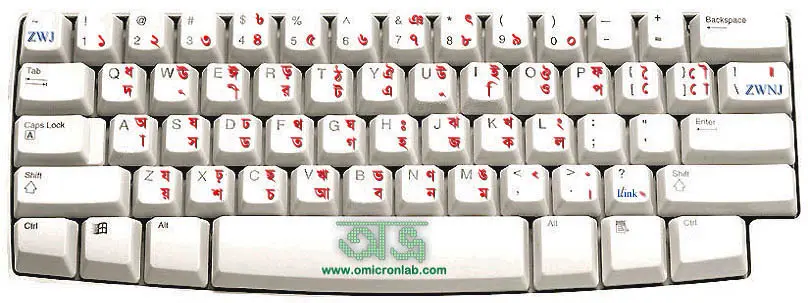
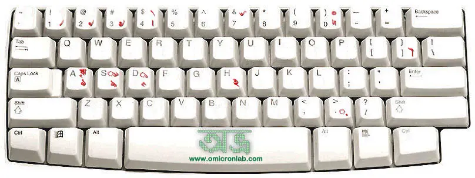

Probhat (প্রভাত) হলো Shabab Mustafa-এর তৈরি একটি জনপ্রিয় Fixed Keyboard Layout ভিত্তিক বাংলা লেআউট। এই লেআউটটি OpenBangla Keyboard-এ সরাসরি অভ্র কিবোর্ড (Avro Keyboard) থেকে আমদানি করা হয়েছে।

**এই লেআউটের বৈশিষ্ট্য**

- Shabab Mustafa-এর তৈরি আরেকটি জনপ্রিয় fixed লেআউট; অভ্র কিবোর্ডে যুক্ত হয়েছে।
- কার Normal লেয়ারে, পূর্ণ স্বরবর্ণ AltGr লেয়ারে; শ/ষ/স-এর বণ্টন অন্য লেআউট থেকে ভিন্ন (`S` = স, `Shift+S` = ষ)।
- AltGr/Shift+AltGr লেয়ারে ঌ, ৠ, ৡ, ৢ, ৣ, ঽ, ৗ, ৸, ৹-সহ বিরল বর্ণ/চিহ্ন।
- `Grave` কী-তে Normal = ZWJ, Shift = `~` — Avro Easy-এর ঠিক উল্টো (Avro Easy-এ Normal = ZWNJ)।
- Shift লেয়ারের ডিজিট রোতে `@`, `#`, `%`, `^`-এর মতো কিছু ASCII চিহ্ন অপরিবর্তিত রাখা হয়েছে।
- যারা Avro Easy পছন্দ করেন কিন্তু Grave কীর আচরণ ভিন্ন চান — Probhat একটি ভালো বিকল্প।

Fixed Layout ভিত্তিক বাংলা লেখার নিয়মগুলো (Modern/Old টাইপিং স্টাইল, Automatic Vowel Forming, হসন্ত/ZWNJ/ZWJ, রেফ, চন্দ্রবিন্দু ঠিক করা, নাম্বার প্যাড ইত্যাদি) জানতে আগে [Fixed Layout Features](/docs/usage/fixed-layout-features) পৃষ্ঠাটি পড়ে নিন। পূর্ণ কী-ম্যাপিং [কী-ম্যাপ](/docs/usage/probhat/keymap) পৃষ্ঠায় দেওয়া আছে।

**বাংলা লেখা শুরু করা:**

১) OBK-র কিবোর্ড লেআউট হিসেবে Probhat সিলেক্ট করুন।

২) কিবোর্ড মোড বাংলা কীবোর্ডে নিয়ে আসুন।

৩) নিচের লেআউট ছবি অনুযায়ী কী চেপে বাংলা লিখতে থাকুন।

 

AltGr ও Shift+AltGr লেয়ারে ঌ, ৠ, ৡ, ৢ, ৣ, ঽ, ৗ, ৸, ৹-এর মতো বাড়তি বর্ণ ও চিহ্ন রাখা হয়েছে:

<Callout type="info">
  <strong>লক্ষ করুন:</strong> উপরের ছবিগুলো অভ্র কিবোর্ডের অফিসিয়াল লেআউট ফাইলে বসানো ছবি (Avro
  Keyboard প্রকল্প / OmicronLab) থেকে নেওয়া হয়েছে। Probhat-এ `Grave` কী (`` ` ``) Normal অবস্থায়
  ZWJ দেয়, আর Shift+`` ` `` থেকে `~` (টিলডা) পাওয়া যায়। এছাড়া Shift লেয়ারের ডিজিট রোতে `@`,
  `#`, `%`, `^`-এর মতো কিছু ASCII চিহ্ন অপরিবর্তিত রাখা হয়েছে।
</Callout>

## উদাহরণ

নিচে কিছু সাধারণ বাংলা শব্দ টাইপ করার ধাপ দেখানো হলো। Modern টাইপিং স্টাইলে (কার ক-এর পরে; হসন্ত `H`) টাইপ করলে যে ধাপগুলো আসে সেটাই দেখানো হয়েছে:

| বাংলা      | কী ধাপ                                                          |
| :--------- | :-------------------------------------------------------------- |
| আমার       | `V` + `M` + `A` + `R`                                           |
| আজ         | `V` + `J`                                                       |
| বংলা       | `B` + `Shift+L` + `L` + `A`                                     |
| ভাষা       | `Shift+B` + `A` + `Shift+S` + `A`                               |
| ক্মপিযুটার | `K` + `/` + `M` + `P` + `I` + `Shift+Z` + `U` + `T` + `A` + `R` |
| ধন্যবাদ    | `Shift+Q` + `N` + `/` + `Shift+Z` + `B` + `A` + `Q`             |
| স্বাগতম    | `S` + `/` + `B` + `A` + `G` + `F` + `M`                         |
| মানবতা     | `M` + `A` + `N` + `B` + `F` + `A`                               |
| শিক্ষা     | `X` + `I` + `K` + `/` + `Shift+S` + `A`                         |
| খাদ্য      | `Shift+K` + `A` + `Q` + `/` + `Shift+Z`                         |
| জল         | `J` + `L`                                                       |
| পানি       | `P` + `A` + `N` + `I`                                           |
| ঘর         | `Shift+G` + `R`                                                 |
| দেশ        | `Q` + `[` + `X`                                                 |
| মা         | `M` + `A`                                                       |
| পিতা       | `P` + `I` + `F` + `A`                                           |
| শহর        | `X` + `H` + `R`                                                 |
| রাস্তা     | `R` + `A` + `S` + `/` + `F` + `A`                               |
| স্কুল      | `S` + `/` + `K` + `U` + `L`                                     |
| টাকা       | `T` + `A` + `K` + `A`                                           |
| আমরা       | `V` + `M` + `R` + `A`                                           |
| এখন        | `Y` + `Shift+K` + `N`                                           |
| কি         | `K` + `I`                                                       |
| ছুটি       | `Shift+C` + `U` + `T` + `I`                                     |
| গান        | `G` + `A` + `N`                                                 |
| দিন        | `Q` + `I` + `N`                                                 |
| রাত        | `R` + `A` + `F`                                                 |
| সব         | `S` + `B`                                                       |

`` `Shift+X` `` মানে `Shift` চেপে `X` কী; `` `AltGr+G` `` মানে `AltGr` চেপে `G` কী; `` `H` `` হলো হসন্ত কী।

এই শব্দগুলো হুবহু টাইপ করে দেখুন, তারপর [Fixed Layout Features](/docs/usage/fixed-layout-features)-এর নিয়মগুলো মিলিয়ে নিন।
